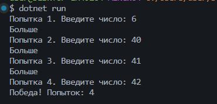
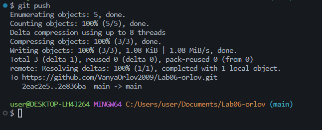

# Практическая работа №6
**ФИО:** Орлов Иван Леонидович
**Группа:** ИСП-241
**Дата:** 07.11.2026

## Что изучено

- while работает пока верно условие, а do while сначала выполняет тело и только потом проверяет условие
- научился накапливать сумму и считать количество
- break полностью останавливает цикл а continue пропускает щаг и идёт дальше

